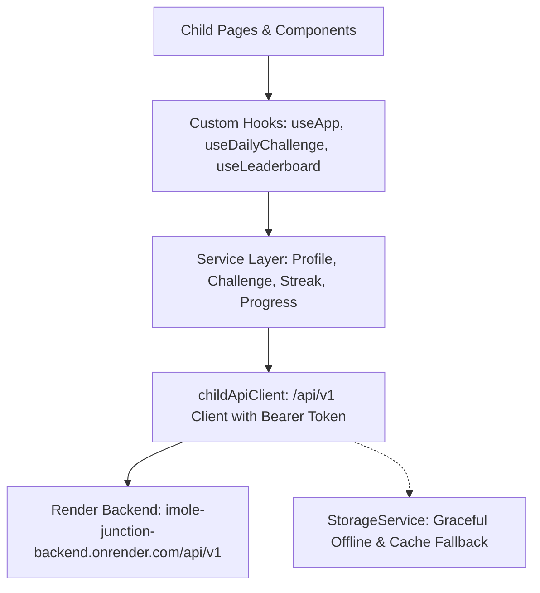

# Child Flow Backend Integration & Implementation Plan

This document outlines the architecture, verified endpoints, and step-by-step implementation plan for integrating the hosted Imole Junction backend (`https://imole-junction-backend.onrender.com/api/v1`) into the Child flow.

---

## 1. Verified Backend Endpoints & Live Test Results

> [!IMPORTANT]
> **API Base URL:** All endpoints are mounted under `/api/v1` (i.e. `https://imole-junction-backend.onrender.com/api/v1`).
> Testing has confirmed live connectivity to the production backend on Render.

| Endpoint | Method | Status | Live Verified Payload & Response |
| :--- | :--- | :--- | :--- |
| `/children` | **POST** | ✅ Verified | **Request:** `{ name: "Ada", age: 10, preferredLanguage: "en" }` **Response:** `{ success: true, childId, anonymousUsername: "CleverEagle101", token: "..." }` *Note: Token issued ONCE. Persisted in `localStorage`.* |
| `/children/me` | **GET** | ✅ Verified | **Headers:** `Authorization: Bearer <token>` **Response:** `{ success: true, child: { _id, name, age, preferredLanguage, anonymousUsername, createdAt, updatedAt } }` |
| `/children/me` | **PATCH** | ✅ Verified | **Request:** `{ name?: "Ada Updated", preferredLanguage?: "yo" }` **Response:** `{ success: true, child: { ... } }` |
| `/children/me/challenge/today` | **GET** | ✅ Verified | **Response:** `{ success: true, assignmentId, locked: false, completedAt: null, challenge: { id, skillId, type: "text" \| "multiple_choice", difficulty: "hard", language: "en", prompt: "...", options: [] } }` *When submitted: `locked: true` and `completedAt: "2026-10-13T..."`.* |
| `/children/me/challenge/today/submit` | **POST** | ✅ Verified | **Request:** `{ responseText: "..." }` or `{ selectedOption: "..." }` **Response:** `{ success: true, pointsEarned: 5, isCorrect: null, streak: { currentStreak: 1, bestStreak: 1, lastActiveDate }, submission: { ... } }` |
| `/children/me/challenge/today/swap` | **POST** | ✅ Ready | Returns new challenge of same skill (max 2/day before answering). |
| `/children/me/streak` | **GET** | ✅ Verified | **Response:** `{ success: true, currentStreak: 1, bestStreak: 1, lastActiveDate: "..." }` |
| `/children/me/progress` | **GET** | ✅ Verified | **Response:** `{ success: true, totalCompleted: 1, totalPoints: 5, skills: [{ skill: { slug, name }, score: 5, challengesCompleted: 1 }], recentSubmissions: [...] }` |
| `/children/me/link-code` | **POST** | ⚠️ Needs Fallback | Generates 6-char parent linking code (falls back to local code generator if server Redis cache is unavailable). |
| `/leaderboard` | **GET** | ⚠️ Needs Fallback | `?period=weekly\|all_time` (falls back to local/mock leaderboard if server Redis cache is unavailable). |

---

## 2. Core Architecture & Client Design

### 1. `childApiClient.ts`
- **Base URL:** `import.meta.env.VITE_API_URL || 'https://imole-junction-backend.onrender.com/api/v1'`
- **Token Management:**
  - `getChildToken()`: Reads `imole_v1_child_token` from `localStorage`.
  - `setChildToken(token)`: Saves token.
  - `clearChildToken()`: Clears token on reset/logout.
- **Request Wrapper:**
  - Auto-attaches `Authorization: Bearer <token>` when available.
  - Includes `AbortController` timeout (15s for Render cold starts).
  - Handles HTTP 401 (token expiration) by clearing token gracefully.

### 2. Resilience & Offline Fallback Strategy
- **Render Cold Starts:** When Render is sleeping (10-30s delay on first request), UI presents a non-blocking toast/indicator while maintaining cached state.
- **Server Cache Failures:** If `/leaderboard` or `/children/me/link-code` returns an error, the frontend seamlessly falls back to local data so children are never blocked from learning.

---

## 3. Step-by-Step Implementation Plan

### Step 1: Create API Client & Types
- [ ] Create `src/types/childApi.ts` matching the backend schema.
- [ ] Create `src/services/api/childApiClient.ts` with token helpers and robust fetch wrappers.

### Step 2: Refactor Services to Backend-First
- [ ] Refactor `profileService.ts`:
  - `createProfile()` calls `POST /api/v1/children`, stores token & anonymousUsername, updates local profile.
  - `getProfile()` hydrates from cache and syncs with `GET /api/v1/children/me`.
  - `updateProfile()` calls `PATCH /api/v1/children/me`.
  - `generateLinkCode()` calls `POST /api/v1/children/me/link-code` with local fallback.
- [ ] Refactor `challengeService.ts`:
  - `getDailyChallenge()` fetches today's backend challenge from `GET /api/v1/children/me/challenge/today`.
  - `swapDailyChallenge()` calls `POST /api/v1/children/me/challenge/today/swap`.
- [ ] Refactor `submissionService.ts`:
  - `submitResponse()` sends `selectedOption` or `responseText` to `POST /api/v1/children/me/challenge/today/submit`.
- [ ] Refactor `streakService.ts` & `progressService.ts`:
  - Fetch live streak from `GET /api/v1/children/me/streak`.
  - Fetch live progress and skill stats from `GET /api/v1/children/me/progress`.
- [ ] Refactor `leaderboardService.ts`:
  - Fetch from `GET /api/v1/leaderboard` with local fallback.

### Step 3: Connect Pages & UI Components
- [ ] **AboutYourselfPage (`/child/about-yourself`)**:
  - Connect form submission to `ProfileService.createProfile()`.
  - Redirect seamlessly to `/child/dashboard` or welcome.
- [ ] **HomeDashboardPage (`/child/dashboard`)**:
  - Display live prompt, skill badge, live streak count, and completed status (`locked` / `completedAt`).
- [ ] **DailyChallengePage (`/child/challenge`)**:
  - Render backend challenge format (`multiple_choice` options or `text` prompt).
  - Add **"Swap Challenge"** button with swaps remaining count.
  - Submit directly to backend and trigger feedback modal.
- [ ] **LeaderboardPage (`/child/leaderboard`)**:
  - Toggle between Weekly & All-Time periods.
  - Display real ranks with highlighted current user.
- [ ] **ChildSettingsPage (`/child/settings`)**:
  - Add "Link with Parent" generator modal showing 6-digit code and 10-minute timer.
  - Connect language selection to `PATCH /children/me`.

### Step 4: Verification & Build
- [ ] Run full test flow (onboard child -> view challenge -> submit challenge -> view streak & progress -> test settings).
- [ ] Run `npm run build` and ensure TypeScript and Vite build pass with zero errors.
